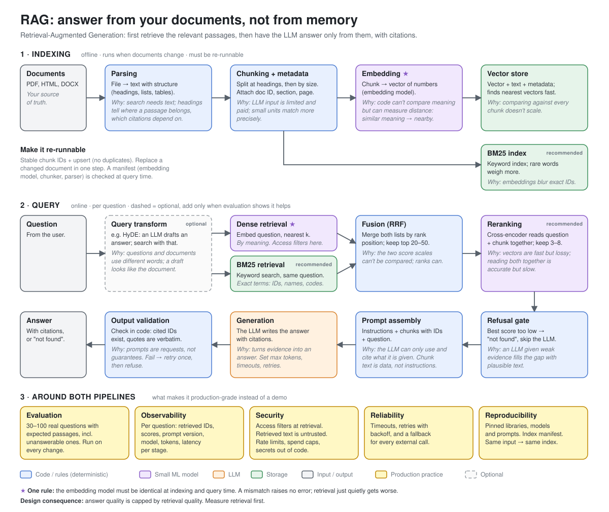

# Looyer

Simple RAG pipeline for answering legal queries.

### Pipeline



Each part explained, and how Looyer implements it and switches it between local and online: [docs/design.md](docs/design.md).

### Source data:

- 1987 Constitution
- Civil Code

(More to come..)

### Getting started

0. Populate .env based on env.sample

1. Install dependencies: `pipenv install`

2. Download models using: **get_hf_model.py**

3. Start Qdrant and the LLM servers: `docker compose up -d` (see [Services](#services-docker-compose))

### Future optimizations

- HierarchicalNodeParser for more hierarchy control when parsing

- Multi domain index

- Meta data filters during retrieval

- Evaluation

- Query caching

- Guardrails

- Security considerations

## Services (Docker Compose)

`compose.yaml` runs the services the app can use. All ports are bound to `127.0.0.1`.

| Service | Container | Port | Used for |
|---|---|---|---|
| `qdrant` | looyer-qdrant | 6333 | Vector store (data in `./data/qdrant`) |
| `answer` | looyer-answer | 8080 | LLM role `answer`: Phi-4-reasoning |
| `hyde_extractor` | looyer-hyde-extractor | 8081 | LLM role `hyde`: Qwen3-4B-Instruct-2507 |
| `embed` | looyer-embed | 11434 | Embeddings (Ollama), only when `EMBED_API_BASE` is set |

```
docker compose up -d                 # start all four
docker compose up -d qdrant          # indexing only needs Qdrant (no LLM)
docker compose exec embed ollama pull bge-m3   # once, after the first start of embed
docker compose ps                    # wait for (healthy): loading a model takes a while
docker compose logs -f answer        # follow one server's log
docker compose down                  # stop everything (data in ./data/qdrant is kept)
```

### LLM servers

The app reaches every LLM through the OpenAI-compatible API (`/v1/chat/completions`), so
the same code works with llama.cpp `llama-server`, vLLM or a hosted API: only `.env` changes
(`{ROLE}_API_BASE`, `{ROLE}_MODEL_NAME`, `{ROLE}_API_KEY`, see `env.sample`). Model-specific
settings (chat template, reasoning, sampling defaults) live in the server commands in `compose.yaml`.

Both servers use the GGUF files already in `.cache/hf` (downloaded by `get_hf_model.py`). The
whole `.cache/hf` folder is mounted because the snapshot files are symlinks into its `blobs/`
folder. The llama.cpp image is pinned to a build tag (`server-bNNNNN`); `:server` changes daily.

`answer` (Phi-4-reasoning) flags:

- `--chat-template-file`: the template embedded in this GGUF is broken (mixes Phi-3 tokens), and
  Microsoft's official one drops system messages; `llm-server/phi-4-reasoning.jinja` fixes both.
- `--reasoning-format deepseek`: the reasoning is returned in `reasoning_content`, separate from
  the answer in `content`. The app only reads `content`.
- `--reasoning-budget 4096`: caps the reasoning; the server then ends it so the model answers.
  The `answer` role's `max_tokens` (profiles.json) = this budget + room for the answer.
- `--ctx-size` must be at least the role's `context_window` in `components/llm/profiles.json`.
- `--parallel 1`: one request at a time gets the whole context (single-user CPU setup).
- `--threads` comes from `LLM_THREADS` in `.env` (start with the physical core count). Both
  servers use it, which is fine because a question calls `hyde` and then `answer`, never both at once.

Check a server directly: `curl http://127.0.0.1:8080/health` returns `{"status":"ok"}`
(HTTP 503 while the model is loading).

## Graphify (optional)

Local knowledge graph of the codebase for AI coding assistants. Output goes to `graphify-out/` (gitignored).

```
# Install the skill and hooks for Claude Code
pipenv run python -m graphify install --project

# Generate the graph (local, no LLM)
pipenv run python -m graphify update .

# Update the graph after code changes (only changed files are re-parsed)
pipenv run python -m graphify update .

# Remove the skill and hooks, then delete the generated graph
pipenv run python -m graphify uninstall --project
rm -rf graphify-out/
```
