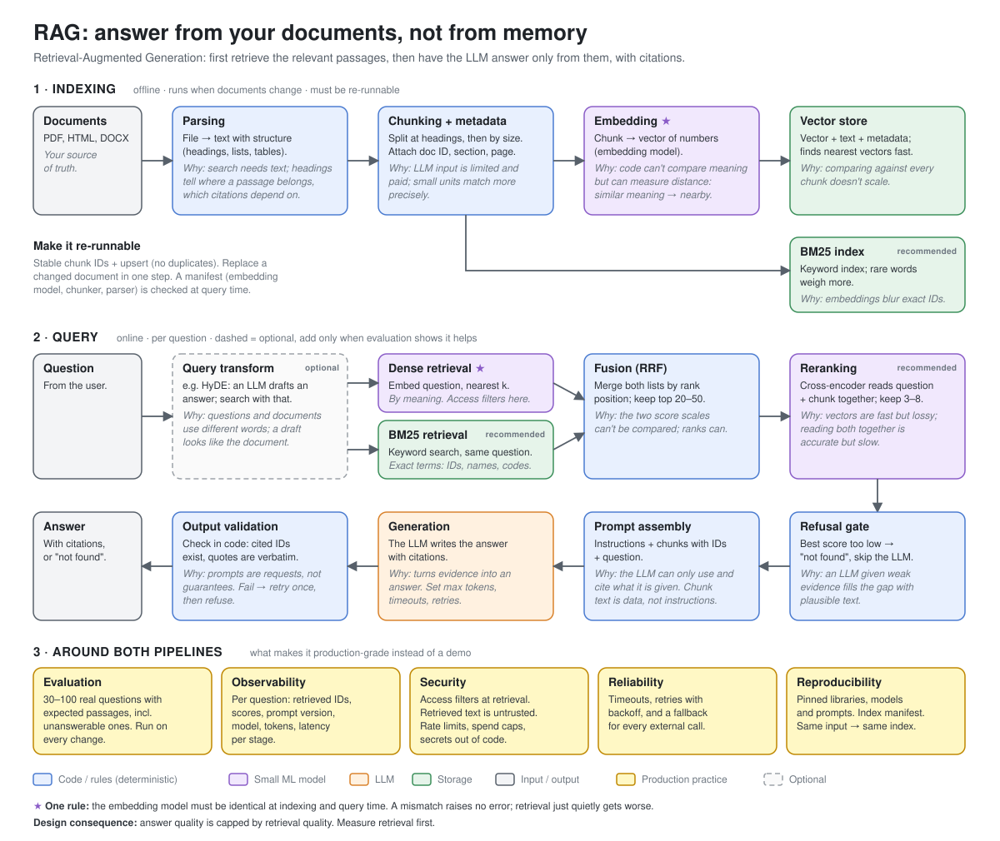

# RAG systems: a bird's-eye view



For engineers who build production software but haven't built a RAG system. After
reading this you should know what to build first, what to add later, and what breaks in
production. How this repo implements it is in the [appendix](#appendix-looyer).

## 1. The problem

An LLM answers from what it memorised during training. That knowledge is frozen, has
gaps, and can't be checked: it will state a wrong fact as fluently as a right one.

**RAG (Retrieval-Augmented Generation)**: at question time, *retrieve* the relevant
passages from your own documents and give them to the LLM with the question, so it
*generates* an answer from evidence you control and can cite.

The consequence for design: **answer quality is capped by retrieval quality.** If the
right passage isn't retrieved, no model or prompt can fix the answer. Most of the
engineering goes into retrieval and into measuring it.

## 2. The shape: two pipelines

```
INDEXING (offline, per document change)
  documents → parse → chunk → embed → store (vectors + text + metadata)

QUERY (online, per question)
  question → [transform] → retrieve → [fuse] → [rerank] → build prompt → generate → validate → answer
                                                                       [ ] = optional, add when measured
```

Same split as a search engine: an expensive, repeatable build step, and a cheap read
path. The two meet in one place, the **embedding model**, which must be identical on both
sides (see §5).

## 3. Indexing pipeline

| Step | What it does | Why it exists | Production notes |
|---|---|---|---|
| **Parsing** | PDF / HTML / DOCX → plain text with structure (headings, lists, tables), usually Markdown. | Retrieval works on text, and structure tells you where one topic ends and which section a sentence belongs to. | The quality floor of the whole system. Inspect the output by eye; a lost heading becomes a wrong citation later. Cache by file hash. |
| **Chunking** | Splits text into passages (chunks), ideally at structural boundaries (headings), then by size. | The LLM can only take a limited, paid-for amount of text, and smaller units retrieve more precisely. Too small loses context; too large dilutes the match. | Start with structure-aware splitting, ~200–500 tokens. Never emit heading-only chunks. Tune with evaluation, not intuition. |
| **Metadata** | Attaches fields to each chunk: document ID, title, section, page, version, access level. | Needed for citations, filtering (by law, date, tenant), and replacing a document later. | Decide which fields go *into* the embedded text (titles help) and which don't (file paths are noise). |
| **Embedding** | Turns each chunk into a vector (a list of ~384–3072 numbers) with an embedding model. | Computers can't compare meaning, but they can measure distance between vectors. Similar meaning → nearby vectors. | A model choice is an index choice: changing it means re-embedding everything. Batch the calls; record model name and version. |
| **Vector store** | Database that stores vectors with their text and metadata and finds the nearest vectors fast (approximate nearest-neighbour search). | Brute-force comparison against every chunk doesn't scale. | Qdrant, pgvector, Weaviate, etc. pgvector is fine to start if you already run Postgres. Store the text and metadata with the vector; a vector alone is useless. |
| **Keyword index** *(recommended)* | Classic full-text index scored with **BM25** (word overlap, weighted so rare words count more). | Embeddings blur exact tokens: IDs, article numbers, product codes, names. Keyword search catches them. | Many vector stores offer this built in ("hybrid search"). Must stay in sync with the vector store. |

**Idempotent indexing** is the part tutorials skip:
- Give every chunk a **stable ID** derived from document ID + position or content hash, and *upsert*, so re-running indexing doesn't create duplicates.
- **Replace by document**: when a document changes, delete its old chunks and insert the new ones as one operation.
- Write an **index manifest**: embedding model, chunker settings, parser version, document hashes. The query side checks it.

## 4. Query pipeline

| Step | What it does | Why it exists | Production notes |
|---|---|---|---|
| **Query transformation** *(optional)* | Rewrites the question before searching. E.g. **HyDE**: an LLM drafts a hypothetical answer, and you search with that. | Questions and documents are worded differently ("can I get out on bail?" vs "all persons shall be bailable"). A draft answer looks more like the document. | Adds one LLM call of latency. Fall back to the raw question if the call fails or returns nothing. |
| **Retrieval (dense)** | Embeds the question with the *same* model and fetches the top-k nearest chunks. | The core of RAG: find by meaning. | Apply **metadata filters here**, especially access control: a user must never retrieve a chunk they aren't allowed to see. Filtering after generation is too late. |
| **Retrieval (sparse)** *(recommended)* | BM25 search with the question. | Covers exact terms that dense search misses (see §3). | Dense + sparse together = **hybrid retrieval**. |
| **Fusion** | Merges the result lists. Standard method: **RRF** (Reciprocal Rank Fusion), which scores by rank position, not raw score. | Dense and BM25 scores are on different scales and can't be compared; ranks can. | Fetch more than you need here (e.g. 20–50), and let the reranker narrow it down. |
| **Reranking** *(recommended)* | A **cross-encoder** model reads question + chunk together and scores relevance; keep the top 3–8. | Embeddings compress each text separately, so they're fast but lossy. Reading both together is accurate but slow, so it only runs on the shortlist. | Often the biggest quality gain per line of code, and often the biggest local CPU cost. Measure latency. |
| **Refusal gate** | If the best rerank score is below a threshold, answer "not found in the documents" without calling the LLM. | An LLM given weak evidence fills the gap with plausible text. Deciding in code is deterministic and free. | Set the threshold from the evaluation set, not by guess. |
| **Prompt assembly** | System instructions + retrieved chunks (each with an ID and source) + the question. | The LLM can only use and cite what's in the prompt. | Instruct: answer only from the passages, cite chunk IDs, say when the passages aren't enough. Treat chunk text as **data, not instructions** (prompt injection). Version the prompt like code. |
| **Generation** | The LLM writes the answer. | Turns passages into an answer in the user's terms. | Set `max_tokens`, timeouts and retries. Reasoning ("thinking") models spend tokens before answering: budget for it. Pin the model version. |
| **Output validation** | Checks the answer in code: cited IDs exist in the given chunks, quoted text appears verbatim, format is as required. On failure: retry once, then refuse. | Prompts are requests, not guarantees. Anything that must be true has to be checked. | Cheap, deterministic, and catches the worst failure: confident citations of things that weren't retrieved. |

## 5. Minimal first version vs later

Build the minimal version end to end first, with evaluation, then add parts only when the
evaluation shows they help.

| Minimal (version 1) | Add when measured |
|---|---|
| Parse, structure-aware chunking, metadata | Hybrid retrieval (BM25 + fusion), usually the first addition |
| One embedding model, one vector store | Reranker |
| Dense retrieval, top-k ≈ 5 | Query transformation (HyDE, rewriting, multi-query) |
| Prompt with citations and "say if not enough" | Refusal gate tuned on scores |
| Output validation (citations exist) | Caching (embeddings, frequent questions) |
| Idempotent indexing + manifest | LLM-extracted metadata (verify it, it hallucinates too) |
| Evaluation set + per-stage logging | Agents, multi-step retrieval, graph RAG |

The evaluation set and logging are in version 1 on purpose: without them every later
change is a guess.

## 6. Evaluation

A **golden set**: 30–100 real questions, each with the passages that should be retrieved
and the key facts the answer must contain. Include questions the documents *can't*
answer.

Measure retrieval and generation separately, so a failure points at a stage:

| Metric | Measures | Question it answers |
|---|---|---|
| **Recall@k** | Share of expected passages found in the top k | Did we retrieve the evidence? |
| **MRR** (mean reciprocal rank) | How high the first correct passage ranks | Is the evidence near the top? |
| **Faithfulness / groundedness** | Whether every claim is supported by the given passages | Did the LLM stick to the evidence? |
| **Citation accuracy** | Whether cited passages exist and support the claim | Can the user trust the references? |
| **Refusal accuracy** | Unanswerable questions refused, answerable ones not | Does it know when it doesn't know? |
| **Latency, cost** | Per stage and per question | Can we afford to run it? |

Retrieval metrics are deterministic: compute them in code. For answer metrics, use
deterministic checks first (facts present, citations valid) and an LLM-as-judge only for
the rest, with its scores spot-checked by a human. Run the set on every change to chunking,
models, prompts or k.

## 7. Failure modes that reach production

| Symptom | Usual cause | Prevention |
|---|---|---|
| Good docs, bad answers | Right passage not retrieved | Measure recall@k; add hybrid search and reranking |
| Retrieval quietly gets worse | Embedding model changed (or version bumped) without re-indexing; no error is raised | Store the model in the manifest; refuse to start on mismatch |
| Duplicate or outdated passages | Re-indexing appends instead of replacing | Stable chunk IDs, upsert, replace by document |
| Confident wrong citation | LLM cites something not in the prompt | Output validation |
| Answers when it shouldn't | Weak evidence, no refusal path | Refusal gate + "not enough" instruction + unanswerable questions in the eval set |
| Wrong citation section | Parsing lost headings | Inspect parsed output; tests on the parser |
| A user sees another user's data | Filtering after retrieval, or not at all | Access-control filters inside the retrieval query |
| Model follows instructions found in a document | Prompt injection | Treat retrieved text as data; no tools or actions driven by retrieved text without checks |
| Slow or expensive | Too many chunks, large rerank set, reasoning model on every step | Per-stage timing; reasoning only where it measurably helps |

## 8. Production checklist

- **Reproducible:** pinned library, model and prompt versions; index manifest; the same input gives the same index.
- **Observable:** per question, log the question, retrieved chunk IDs and scores, prompt version, model, tokens, and latency per stage. Without this you can't debug a bad answer.
- **Reliable:** timeouts, retries with backoff, and a defined fallback for every external call (embedding, LLM, vector store).
- **Secure:** access control at retrieval; secrets out of code; retrieved text treated as untrusted; rate limits and spending caps on paid APIs.
- **Evaluated:** golden set in CI; a change ships only if the metrics don't regress.
- **Operable:** re-index and replace-a-document are single commands; vector store backed up; startup checks fail fast with a clear message.

---

## Appendix: Looyer

Looyer answers questions about Philippine law (1987 Constitution, Civil Code) in IRAC
format with verbatim citations. Run `python main.py run-embed <file>` to index and
`python main.py "<question>"` to ask.

| Part | Looyer's choice | Code |
|---|---|---|
| Parsing | pymupdf4llm or Docling → Markdown, cached by file hash; rule-based heading repair | `components/loader/`, `components/transformer/extractors.py` |
| Chunking | Markdown headings, then semantic split; article/section metadata from headings | `components/transformer/chunking.py` |
| Embedding | bge-m3 (1024 dimensions), in-app (OpenVINO) or on an Ollama server | `components/embedding/config.py` |
| Vector store | Qdrant (Docker or Qdrant Cloud) | `components/vector_store/config.py`, `components/indexer/index.py` |
| Keyword index | BM25, cached on disk, rebuilt when the collection changes | `components/retrieval/retriever.py` |
| Query transformation | HyDE; falls back to the question if the draft is empty | `components/retrieval/retriever.py` (`_CheckedHyDE`) |
| Fusion | RRF over dense + BM25, top 20 | `components/retrieval/retriever.py` |
| Reranking | bge-reranker-base, top 5 | `components/reranker/rerank.py` |
| Prompt + generation | IRAC template, any OpenAI-compatible LLM | `components/synthesizer/`, `components/llm/` |
| Startup checks | Qdrant reachable, embedding dimension matches the collection, LLM servers reachable | `main.py` |

**Switching local ↔ online** is a `.env` change, never a code change:

| Part | Settings |
|---|---|
| Vector store | `QDRANT_URL`, `QDRANT_API_KEY`, `COLLECTION_NAME` |
| Embedding | `EMBED_API_BASE` (empty = in-app), `EMBED_MODEL_NAME`, `EMBED_API_KEY` |
| HyDE LLM | `HYDE_API_BASE`, `HYDE_MODEL_NAME`, `HYDE_API_KEY` |
| Answer LLM | `ANSWER_API_BASE`, `ANSWER_MODEL_NAME`, `ANSWER_API_KEY` |

Per-role LLM settings (length limit, temperature, reasoning on/off) are in
`components/llm/profiles.json`.

**Not built yet**, against the checklist above: stable chunk IDs and replace-by-document,
index manifest (only the dimension is checked), golden set and metrics, refusal gate,
citation validation, structured logging, retries for cloud calls.
